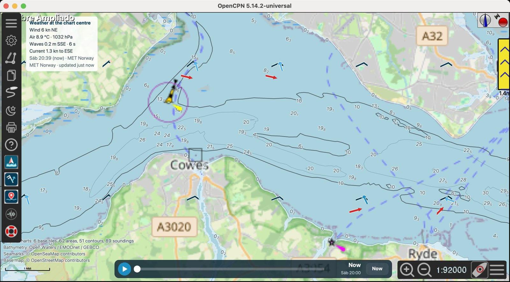
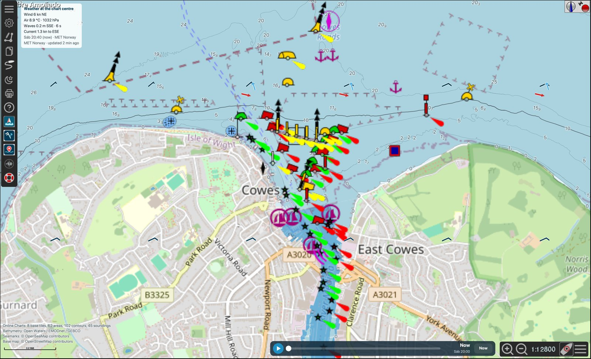
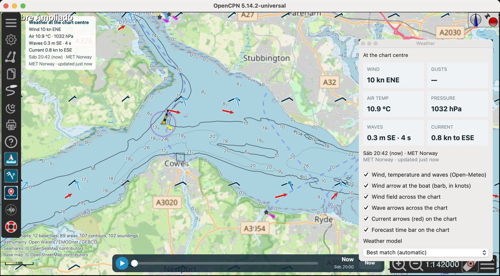

# OpenCPN Online Charts

A native [OpenCPN](https://opencpn.org) plugin that draws free online marine data directly on the OpenCPN chart:

- **Bathymetry** from Open Waters Seascape: depth colours, contours and soundings, in metres or feet. Depth colours by band as on a paper chart (light blues) or **Topo**, from red in the shallows to deep blue, as in the GPS Charts extension.
- **Seamarks** from OpenSeaMap: buoys, beacons, lights with their sectors, harbours and restricted areas.
- **Base map** (optional, off by default): Esri World Ocean Base or OpenStreetMap below the bathymetry, with adjustable opacity. OpenCPN draws plugins above its charts, so the base map covers them.
- **AIS demo** (optional): live vessels in the chart view from [Open Waters AIS](https://openwaters.io/ais/), shown as OpenCPN's own AIS targets. Testing only, not for navigation.
- **Marine weather** from Open-Meteo, falling back to MET Norway:
  - wind barbs to the standard convention, wave arrows and red ocean-current arrows across the chart;
  - a Weather window with the conditions and the forecast model;
  - a forecast time bar on the chart covering the next 72 hours;
  - a 72-hour offline cache.
- **Open provider** button that opens i-Boating, C-MAP or Garmin Marine in the web browser at the boat position.
- **Offline bathymetry cache** with prefetch of the visible area.
- **Fast drawing**: about 5 ms per frame in OpenGL on a Retina Mac.

> **Not for navigation.** This is an experimental display of public data. It is not an ENC, not C-MAP or i-Boating data, and depths are not reduced to chart datum. Always carry and use official charts and official forecasts.

## Screenshots



*The Solent: bathymetry, seamarks, wind barbs, wave arrows (blue), tidal current arrows (red) and the forecast time bar next to OpenCPN's zoom controls.*



*Cowes harbour: OpenSeaMap lights and buoys over Open Waters soundings and contours, on the OpenStreetMap base map.*



*The Weather window: conditions at the forecast time, layer switches and the forecast model.*

## Install

1. Download the package for your system from the [Releases](../../releases) page:
   - **macOS 11 or later**, universal (Intel and Apple Silicon): `OnlineCharts-…-darwin-wx32-10-universal.tar.gz`.
   - **Debian 12 / Ubuntu-based Linux**, x86-64: `OnlineCharts-…-debian-x86_64-12-x86_64.tar.gz`.
   - **Raspberry Pi OS** (Raspberry Pi 3 or later), one package per Raspberry Pi OS release and per 32 or 64 bits:

     | Raspberry Pi OS | 32-bit | 64-bit |
     |---|---|---|
     | Bookworm (Debian 12) | `OnlineCharts-…-debian-armhf-12-armhf.tar.gz` | `OnlineCharts-…-debian-arm64-12-arm64.tar.gz` |
     | Trixie (Debian 13) | `OnlineCharts-…-debian-armhf-13-armhf.tar.gz` | `OnlineCharts-…-debian-arm64-13-arm64.tar.gz` |

     `cat /etc/debian_version` gives the release (12.x is Bookworm, 13.x is Trixie) and `dpkg --print-architecture` says `armhf` (32-bit) or `arm64` (64-bit). OpenCPN refuses a package for another Debian release with *Incompatible import plugin detected*.
   - **Windows 10/11** with a 32-bit OpenCPN (every Windows OpenCPN from 5.8 to 5.14.0): `OnlineCharts-…-msvc-wx32-10-x86.tar.gz`.
   - **Windows 10/11** with a 64-bit OpenCPN (5.14.2 or later): `OnlineCharts-…-msvc-64-10-x86_64.tar.gz`.

   On Windows the package must match OpenCPN, not Windows: a 64-bit Windows can run a 32-bit OpenCPN. OpenCPN is 32-bit when it is installed in `C:\Program Files (x86)\OpenCPN`, or when Task Manager's *Processes* tab shows it as `OpenCPN (32 bit)`. The wrong package is refused with *Incompatible import plugin detected*.
2. In OpenCPN open **Options → Plugins**, choose **Import plugin…** and select the downloaded `.tar.gz`. Do not unpack or rename it.
3. Enable **OnlineCharts** in the plugin list and restart OpenCPN if asked.
4. Three buttons appear in the toolbar:
   - **Online Charts** opens the quick panel (below): display brightness, the layers, depth colours, base map, seamarks and AIS demo, Locate boat, the Weather window and the full settings.
   - **Weather** shows or hides the Weather window.
   - **Open provider** (red pin) opens i-Boating, C-MAP or Garmin Marine at the boat.

Packages are platform-specific. The plugin needs OpenCPN 5.8 or later (plugin API 1.18). It was developed and tested with OpenCPN 5.14.2.

## Chart layers

The plugin reads public MVT/PBF tiles from:

`https://tiles.openwaters.io/seascape/{z}/{x}/{y}.pbf`

It renders the `depare`, `contours` and `soundings` layers over the current OpenCPN viewport. The depth colours come from Open Waters' elevation raster, `https://tiles.openwaters.io/seascape/{z}/{x}/{y}.webp` (512-pixel WebP tiles, terrarium encoding, up to zoom 15 here), coloured per pixel like the extension's MapLibre `color-relief` layers. The vector `depare` layer holds only drying areas, so it is drawn only when the raster is unavailable, for example offline. The raster is network-only, like the base map; wxWidgets 3.2 cannot read WebP, so the plugin includes the libwebp decoder. New tiles are downloaded asynchronously and the canvas is refreshed when data becomes available. No protected C-MAP or i-Boating vector endpoint is accessed or bypassed.

The native disk cache is stored below the OpenCPN user data directory in `online_charts_pi/vector_cache`. It uses configurable freshness and size limits, supports offline-only operation and can prefetch the visible area by additional zoom levels. A tile past its refresh age is still drawn until a newer one arrives. When the cache passes its size limit (or 20000 tiles) the oldest downloads are removed down to 90%, but never the tiles of the latest saved area. The auxiliary browser dashboard has its own separately configurable cache.

### Drawing order

In the OpenGL canvas the base map, bathymetry and seamarks are drawn in OpenCPN's chart pass (`OVERLAY_CHARTS`). That is right after the charts and below OpenCPN's routes, waypoints, tide and current stations, AIS targets and own ship. The weather symbols, panel and forecast time bar are drawn in the legacy pass above them. Before 1.4.0 everything was drawn in the legacy pass, so the opaque base map hid the tide and current stations, routes and waypoints, and the plugin was also drawn twice per frame. OpenCPN calls both `RenderGLOverlay` and `RenderGLOverlayMultiCanvas` for API 1.18 plugins, so the plugin now draws only in the multi-canvas callbacks. Hosts without the chart pass get the chart layers in the legacy pass. In the wxDC (non-OpenGL) canvas OpenCPN draws tide and current stations after the plugins, so they stay visible there too.

OpenCPN has no plugin pass below its charts, so everything the plugin draws covers the charts, o-charts included. The base map is therefore off by default since 1.6.0, and both the base map and the depth colours have an opacity setting.

## Quick panel

The **Online Charts** toolbar button opens a small panel with the options used while sailing. Every change applies at once, so its effect shows on the chart beside it, and is saved:

- **Show Online Charts on the chart**: everything the plugin draws, on or off (the button looks pressed while it is on);
- **Display brightness**: **Day**, **75%**, **55%**, **40%** and **Night**, the steps of the extension's brightness button. The plugin draws a filter over the whole chart in OpenCPN's last pass: the chart is dimmed for the three dusk steps, and at night it is inverted (the light chart dark, the dark lines light) and turned red, which keeps night vision. Inverting needs a light chart, so night puts OpenCPN in its day palette (plugin API 1.18 has no call for this: the plugin presses OpenCPN's colour-scheme key, F5, on the chart). OpenCPN's own Day/Dusk/Night (F5) still works; choosing its dusk or night palette ends the plugin's red night. Windows outside the chart (status bar, dialogs) are not filtered. The step is remembered;
- **Depths**: colours **Off**, **Chart** or **Topo**, their **Opacity**, **Contours and soundings**, units **m** or **ft**;
- **Base map**: **Off**, **Esri** or **OSM**, its **Opacity**, and **OpenSeaMap seamarks**;
- **AIS demo**: on or off, with its live status (connection, events, how many targets OpenCPN tracks);
- buttons: **Locate boat** centres the chart on the boat at the current scale (OpenCPN's own follow mode is left as it is; without a position yet the panel says so), **Weather** shows or hides the Weather window, **More settings** opens the preferences dialog.

The choices are buttons rather than lists, with 32-pixel controls for touch screens. The panel stays open while the chart is used, and closes with its close button, Esc or the toolbar button. It follows OpenCPN's day, dusk and night colours.

## Preferences

The settings changed less often (cache, labels, providers, weather) are under **More settings** in the quick panel, or **Options → Plugins → OnlineCharts → Preferences**. The native English dialog has three tabs: **Chart**, **Weather** and **Offline cache and status**. It provides:

- overlay enable, depth contours and labels, point soundings, depth colours and chart status;
- an optional raster base map below the bathymetry, off by default, with **Esri World Ocean Base** (default) or **OpenStreetMap** and an **Opacity (%)**. It is drawn over the OpenCPN charts, o-charts included, because OpenCPN gives plugins no pass below the charts; at 100 % it hides them. Esri's detailed tiles (up to zoom 16) are regional; where they are missing the nearest coarser tile is magnified;
- **Depth colours**: **Chart** (the light blues of a paper chart, a colour per band at 2, 5, 10, 20 and 50 m, drying areas green) or **Topo** (Open Waters' Topo view, as in the GPS Charts extension: red in the shallows through orange, yellow and green to deep blue, drying areas pink), with an **Opacity (%)** so the OpenCPN chart can show through. Land is left clear;
- the **AIS demo** described below;
- **OpenSeaMap seamarks** above the bathymetry (buoys, beacons, lights with their sectors, marinas, cables and restricted areas), on by default, as in the browser dashboard;
- metres or feet, using the unit-specific values published by Open Waters;
- **Depth label size (%)**, 50–300 %: at 100 % the contour and sounding numbers follow the browser dashboard, about 10 px when zoomed out and growing to 18 px when zoomed in;
- measured screen-rectangle collision avoidance shared by contour and sounding labels;
- the **Weather** tab described below;
- cache enable, network-first/cache-first/offline-only mode, maximum size and refresh age;
- **Save visible area for offline use**, with 0–4 additional zoom levels and a 5000-tile safety limit; it reports the estimated size and refuses an area that does not fit in the maximum cache size;
- **Clear cache**, **Refresh status**, visible/ready tile counts, drawn-object counters, the overlay drawing time per frame and the latest network or OpenGL issue.

Choices accepted with **OK** are written to the OpenCPN configuration under `/PlugIns/OnlineCharts` and restored on the next start. The toolbar state is also persistent. Base-chart selection and GPS input remain OpenCPN settings; browser-only provider and serial-port controls are not duplicated in this native dialog.

## AIS demo

**AIS demo** in the **Chart** tab shows live vessels in the chart view from [Open Waters AIS](https://openwaters.io/ais/), as the GPS Charts extension's AIS demo does. It is off by default.

- The plugin reads Open Waters' server-sent events stream (`https://ais.openwaters.io/v1/stream`, anonymous, no key) for the visible area plus a margin, up to the anonymous limit of 100 square degrees, and follows the chart when it moves.
- Each event's raw `!AIVDM` sentences go to OpenCPN with `PushNMEABuffer`, so the vessels are OpenCPN's own AIS targets: CPA/TCPA, the target list and alarms work as with a receiver. Static reports that Open Waters sends without NMEA are encoded as AIS message 5, so the targets have their names.
- The first snapshot holds each vessel's last report, some hours old. OpenCPN dates a target from when it hears it, so positions older than 10 minutes are skipped.
- The sources are credited on the chart, for example *Open Waters AIS · AISHub · aisstream.io*. The status line under the option shows the connection, the events received and how many AIS targets OpenCPN tracks.

Shore stations are close to real time; aisstream.io is about 17 s late and AISHub about a minute. This is not a replacement for an AIS receiver. If OpenCPN forwards NMEA to other devices or networks, these targets go there too; never send them back to an AIS network as your own reception.

## Weather

The plugin adds the marine forecast of the browser extension (0.6.1) to the OpenCPN chart, from [Open-Meteo](https://open-meteo.com) without an API key.

**Weather window.** The **Weather** toolbar button shows or hides a small floating window like the dashboard's *Conditions* section. It has tiles for wind, gusts, air temperature, pressure and waves at the forecast time, the place, time, model and age of the reading, the layer switches and the **Weather model** choice. Changes apply at once and are saved. Closing the window has the same effect as the button. Like other macOS tool windows, it hides while OpenCPN is not the active application.

**Forecast time bar.** A bar on the bottom edge of the chart, the same height as OpenCPN's zoom and scale controls and just to their left (or centred above them on a narrow chart), scrubs the next 72 hours, like the dashboard's timeline. **▶** plays the forecast an hour at a time, dragging the track picks an hour, and **Now** returns to the current hour. Wind, waves, the window and the panel all follow it. Clicks and drags on the bar do not move the chart.

**On the chart.** The wind field and wave arrows (pointing the way the waves travel, coloured by height) cover the visible chart. Hovering over a point shows its wind, gusts, direction and wave height. A larger wind barb is drawn at the boat when OpenCPN has a live GPS fix. Wind barbs follow the standard convention: the staff starts at the position and points to where the wind comes from, with the feathers at its far end on the right, slanting outwards. A pennant (filled triangle) is 50 kn, a full barb 10 kn and a half barb 5 kn, placed pennants first from the tip, then full and half barbs. A lone half barb sits one step in from the tip, and a double circle marks calm (under 2.5 kn). The conditions can also be drawn as a panel on the chart.

| Setting | Where | Effect |
|---|---|---|
| Wind, temperature and waves | Window, Preferences | Turns the forecast on or off (on by default). |
| Wind arrow at the boat | Window, Preferences | Maritime wind barb at the vessel: half barbs 5 kn, full barbs 10 kn, pennants 50 kn. |
| Wind field / Wave arrows | Window, Preferences | On by default. |
| Forecast time bar | Window, Preferences | On by default. |
| Current arrows (red) | Window, Preferences | On by default. Ocean surface current at the forecast time: a red arrow pointing the way the water flows, longer for a stronger current (full length from 3 kn), across the chart and larger at the boat. The window and panel show it as, for example, *0.4 kn to SSW*. |
| Weather model | Window, Preferences | Best match, ECMWF IFS, GFS, ICON, Météo-France or UK Met Office. |
| Conditions panel on the chart | Preferences | Off by default; the window shows the same values. |
| Units | Preferences | °C or °F; metres or feet for waves. |
| Forecast time | Bar, Preferences | Now up to +72 h; it returns to *now* when OpenCPN restarts. |
| Reuse a reading for (minutes) | Preferences | Default 60: newer readings are used without a request. |
| Keep readings for offline use (hours) | Preferences | Default and maximum 72: older readings are still shown without a connection, labelled *Offline · cached N h ago*, then deleted. |

**Where the conditions are taken.** At the boat when OpenCPN has a live GPS fix (a speed or a satellite count); otherwise at the chart centre, and the window says which. Without a GPS, OpenCPN keeps sending its last own-ship position, so that position alone is not used.

**Currents.** Ocean currents come from Open-Meteo Marine (`ocean_current_velocity`, `ocean_current_direction`), with the same request as the waves. The source is Météo-France's SMOC global model, about 8 km resolution, which includes tides: in the Solent it shows the tidal stream reversing. It is not a substitute for tidal stream atlases or local current stations. In narrow estuaries and harbours the model often has no sea cell, and it answers a land point with its nearest sea cell. So wave and current arrows are left out where the terrain is higher than 2 m, using the elevation returned with the wind (Open-Meteo or MET Norway); wind barbs are still drawn there.

**MET Norway when Open-Meteo refuses.** While Open-Meteo refuses requests, the wind and air values come from [MET Norway's Locationforecast](https://api.met.no/) (free, no key, global; data CC BY 4.0). Each field point is one request, four at a time, and each point is cached, as MET Norway's terms ask. The window and panel then show *MET Norway · updated N min ago*. MET Norway has no gusts in this answer, so gusts show a dash. Its hourly steps become 6-hourly after about 2½ days, so a forecast time up to 3 hours from a step uses that step. Waves still come from Open-Meteo Marine, a separate service. Requests identify the plugin with a contact address, as MET Norway requires.

**Open-Meteo limits and the cache.** Open-Meteo's free service has a daily request limit per internet address, and every location in a request counts. The field points therefore sit on a fixed latitude/longitude lattice (from 0.01° to 10°, at most 40 points per view) and are cached one by one, so moving or zooming the chart only requests the points not yet known. Readings are refreshed when older than the reuse time and every few hours while online. When Open-Meteo answers *429 Too Many Requests*, the plugin stops asking: an hour for the daily limit, otherwise from one minute doubling up to an hour. The window then shows *Open-Meteo daily limit reached; cached weather shown*. A reading missing the forecast or the marine answer is shown but not cached, and is requested again later. The extension uses the same service from the same address, so both count towards the same limit.

The weather cache is in `online_charts_pi/weather_cache` below the OpenCPN user data directory. **Refresh weather now** and **Clear weather cache** are in the Preferences. Weather data by Open-Meteo.com (CC BY 4.0). It is not a substitute for an official marine forecast.

## Open provider at the boat position

The **Open provider** toolbar button (red pin) opens a small menu: **Open i-Boating**, **Open C-MAP (Pin location)** or **Open Garmin Marine**. The choice opens in the default web browser at the boat position when OpenCPN has a live GPS fix, otherwise at the chart centre, and the menu says which. i-Boating opens at the chart's current zoom and depth units; C-MAP uses its *Pin location* route. Garmin Marine opens its English page centred on the position, sent as a 12-character geohash in the `key` parameter (the same URL as the GPS Charts extension). Only a click on Garmin's map places its marker, and a native program cannot click inside a browser page. So the plugin opens Garmin in Google Chrome (or Chromium) when installed, with `gpscharts=pin` added: with the [GPS Charts extension](https://github.com/Sail-Tech/gps-charts-chrome) 0.7.1 or later in that Chrome, the extension clicks the map centre once and checks that the marker landed within 500 m of the boat. Without Chrome or the extension, Garmin opens in the default browser, centred, and you click the map centre to mark the boat. This matches the browser dashboard's *Open provider at the boat position*. Following the boat live on those sites still needs the Chrome extension.

## Auxiliary local dashboard

The embedded CivetWeb service listens only on `127.0.0.1`, trying ports **8766–8775**. While the plugin is running, the dashboard can be opened manually at:

`http://127.0.0.1:8766/dashboard.html`

If that port is occupied, use the next port selected by the plugin; `/api/status` reports service state. The toolbar button controls the integrated chart layer and does not launch the dashboard.

The service accepts HTTP `Host` and WebSocket `Origin` values only for the same loopback service. Do not expose it publicly without authentication. C-MAP Pin Location remains temporary until the user explicitly selects an action on the C-MAP page.

The dashboard works best in a current Chromium-based browser. Web Serial requires browser support and user authorization. Cache Storage and browser settings are local to the browser profile and selected local port. The installed `bridge/gps_bridge.py` is optional for extension-compatible TCP/UDP input; OpenCPN positions otherwise arrive through the native `SetPositionFix` callback.

## Data sources and attribution

The plugin only reads public services, as an ordinary client. It does not use credentials, does not bypass access controls, and does not download protected C-MAP or i-Boating data.

| Data | Source | Terms |
|---|---|---|
| Bathymetry (depth areas, contours, soundings) | [Open Waters Seascape](https://openwaters.io/charts/seascape) | CC BY 4.0; underlying EMODnet, GEBCO and other open sources |
| Seamarks | [OpenSeaMap](https://openseamap.org) | CC BY-SA, © OpenSeaMap contributors |
| Base map | [OpenStreetMap](https://www.openstreetmap.org) or [Esri World Ocean Base](https://www.arcgis.com/home/item.html?id=1e126e7520f9466c9ca28b8f28b5e500) | ODbL / © OpenStreetMap contributors (no offline use, per the [tile policy](https://operations.osmfoundation.org/policies/tiles/)); Esri, Garmin, GEBCO, NOAA NGDC and other contributors |
| AIS demo | [Open Waters AIS](https://openwaters.io/ais/) (shore stations, AISHub, aisstream.io and others) | Each source's own terms, credited on the chart as received |
| Weather, waves, ocean currents | [Open-Meteo](https://open-meteo.com) Forecast and Marine APIs | CC BY 4.0; free for non-commercial use within its request limits |
| Weather fallback | [MET Norway Locationforecast](https://api.met.no) | CC BY 4.0 (Norwegian Meteorological Institute) |

The attributions are drawn in the bottom-left corner of the chart and shown in the Weather window.

## Build from source

Requirements:
- CMake, a C++17 compiler, Gettext, and wxWidgets 3.2 development files.
- OpenGL and GLU development files.
- On Linux, also libcurl development files: the distributions' wxWidgets builds disable `wxWebRequest`, so the plugin uses libcurl there.

The OpenCPN plugin API headers, the OpenCPN plugin libraries and CivetWeb are included in the repository. Each build writes the import `.tar.gz`, its XML metadata and a SHA-256 file to `build/`. GitHub Actions ([`.github/workflows/build.yml`](.github/workflows/build.yml)) builds macOS, Windows, Debian 12 and the four Raspberry Pi packages on every push to `main`.

### Debian 12 (x86-64)

```bash
sudo apt-get install cmake g++ make gettext libwxgtk3.2-dev libcurl4-openssl-dev \
  libgl1-mesa-dev libglu1-mesa-dev
cmake -S . -B build -DCMAKE_BUILD_TYPE=Release '-DOCPN_TARGET_TUPLE=debian-x86_64;12;x86_64'
cmake --build build --target tarball --parallel
```

On a distribution whose OpenCPN reports a different plugin target (for example Kali Linux, which reports `debian-x86_64` with version `n/a`), set `OCPN_TARGET_TUPLE` to the values shown in OpenCPN's plugin catalog.

### Raspberry Pi OS

On the Raspberry Pi itself, with the same packages as for Debian 12, the target names the Debian release and the architecture, for example on a 64-bit Trixie:

```bash
cmake -S . -B build -DCMAKE_BUILD_TYPE=Release '-DOCPN_TARGET_TUPLE=debian-arm64;13;arm64'
cmake --build build --target tarball --parallel
```

Use `debian-armhf;12;armhf` and so on for the other three. The CI builds them in `debian:12` and `debian:13` containers: arm64 on an Arm runner, armhf under QEMU.

### Windows 10/11 (Visual Studio 2022)

From a *Developer Command Prompt for VS 2022*, in the repository folder:

```bat
ci\build-windows.bat
```

The script downloads the wxWidgets build dependencies through the ShipDriver helpers and builds the import tarball for the 64-bit OpenCPN (`msvc-64`). For the 32-bit OpenCPN (`msvc-wx32`), in a fresh clone or after deleting the `build` folder:

```bat
set PLATFORM=Win32
ci\build-windows.bat
```

### macOS 11 or later (universal)

Install CMake and Gettext, and OpenCPN's universal macOS dependency bundle (it contains a universal wxWidgets 3.2; a single-architecture Homebrew wxWidgets is not enough):

```bash
brew install cmake gettext
curl -fL https://dl.cloudsmith.io/public/nohal/opencpn-plugins/raw/files/macos_deps_universal.tar.xz \
  -o /tmp/macos_deps_universal.tar.xz
sudo tar -C /usr/local -xJf /tmp/macos_deps_universal.tar.xz
export PATH="/usr/local/bin:$(brew --prefix gettext)/bin:$PATH"
export WX_CONFIG=/usr/local/lib/wx/config/osx_cocoa-unicode-3.2
cmake -S . -B build -DCMAKE_BUILD_TYPE=Release -DCMAKE_OSX_ARCHITECTURES="x86_64;arm64" \
  -DCMAKE_OSX_DEPLOYMENT_TARGET=11.0 "-DOCPN_TARGET_TUPLE=darwin-wx32;10;universal"
cmake --build build --target tarball --parallel
```

For quick tests against an installed OpenCPN, `ci/build-macos-local.sh` compiles only the library, in under a minute:
- It uses the wxWidgets headers of the unpacked dependency bundle and links against the wxWidgets libraries inside `OpenCPN.app`.
- `--install` copies it into `~/Library/Application Support/OpenCPN` and keeps a backup of the previous library. It refuses to run while OpenCPN is open, because overwriting a loaded plugin makes macOS kill OpenCPN.
- With `EXTRA_CFLAGS=-DONLINE_CHARTS_BENCHMARK`, the build redraws the chart 300 times after start-up and logs the average overlay drawing time.

```bash
WXDEPS=/path/to/macos_deps_universal ARCHS="x86_64 arm64" ci/build-macos-local.sh --install
```

### Tests

```bash
c++ -std=c++17 -Isrc tests/json_test.cpp src/online_charts_json.cpp -o json_test && ./json_test
c++ -std=c++17 -Isrc tests/geohash_test.cpp -o geohash_test && ./geohash_test
cc -c -O2 -Ilibs/libwebp libs/libwebp/src/*/*.c && c++ -std=c++17 -Isrc -Ilibs/libwebp tests/depth_test.cpp src/online_charts_depth.cpp *.o -o depth_test && ./depth_test [tile.webp]
c++ -std=c++17 -Isrc tests/aisdata_test.cpp src/online_charts_aisdata.cpp src/online_charts_json.cpp -o aisdata_test && ./aisdata_test [recorded-stream.txt]
```

`tests/server_smoke.cpp` starts the auxiliary dashboard server and broadcasts a test position.

## Project layout

```text
src/online_charts_pi.*            Plugin entry points, toolbar buttons, settings, overlay passes
src/online_charts_overlay.*       Open Waters bathymetry: tiles, cache, OpenGL and wxDC drawing, labels
src/online_charts_land.*          Raster layers: OpenStreetMap / Esri base map, depth colours, OpenSeaMap seamarks
src/online_charts_depth.*         Depth colours (Chart, Topo) from the Open Waters elevation raster
src/online_charts_mvt.*           Mapbox Vector Tile (PBF) parser
src/online_charts_render.*        Fast projection, polygon tessellation, glyph-atlas text, GL helpers
src/online_charts_weather.*       Open-Meteo / MET Norway weather, field lattice, cache, symbols, time bar
src/online_charts_weather_window.*  The floating Weather window
src/online_charts_quick_panel.*   Quick panel of the toolbar button
src/online_charts_preferences.*   Preferences dialog (Chart, Weather, Offline cache and status)
src/online_charts_ais.*           AIS demo: Open Waters stream following the chart, into OpenCPN's AIS
src/online_charts_aisdata.*       Server-sent events, NMEA preparation, AIS message 5 encoding
src/online_charts_http.*          Asynchronous HTTPS (requests and streams): wxWebRequest or libcurl
src/online_charts_json.*          Minimal locale-independent JSON reader
src/online_charts_geohash.h       Geohash and Garmin Marine URL for Open provider
src/online_charts_server.*        Loopback server for the auxiliary dashboard (CivetWeb)
data/                             Toolbar icons and the auxiliary browser dashboard
libs/                             CivetWeb and the libwebp decoder
ci/, cmake/, opencpn-libs/        Build scripts, OpenCPN plugin API and shared plugin libraries
```

## Licence

GPL-3.0-or-later, see [COPYING](COPYING). Third-party components:
- The OpenCPN plugin API and the ShipDriver build infrastructure.
- CivetWeb 1.16, MIT licence (`libs/civetweb/LICENSE.md`).
- libwebp 1.6.0 decoder, BSD licence (`libs/libwebp/COPYING`, `PATENTS`).
- MapLibre GL JS 5.24.0 (`data/online_charts/vendor/LICENSE.txt`).

Map and weather data stay under the terms of their providers (see above). See [CHANGELOG.md](CHANGELOG.md) for the release history.
